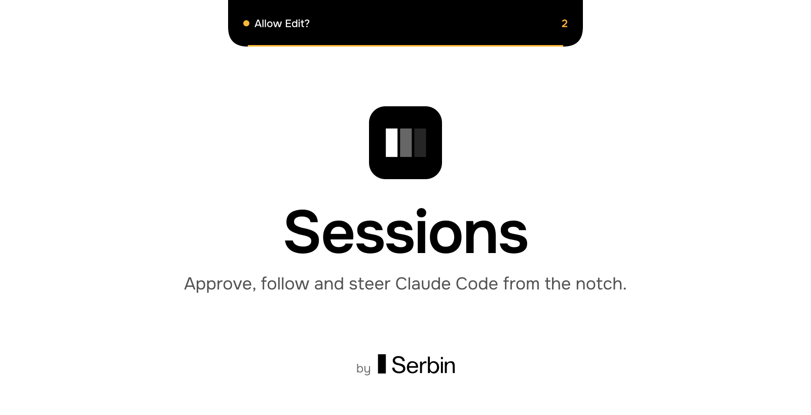
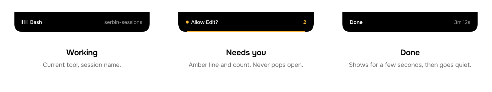

<picture>
  <source media="(prefers-color-scheme: dark)" srcset="assets/readme/hero-dark.svg">
  
</picture>

<p align="center">
  <b>macOS 14+</b> · for <a href="https://code.claude.com">Claude Code</a> · v0.1.0
</p>

---

Sessions lives in the notch of your Mac. It stays a flat black pill while Claude Code works, shows a thin amber line when something needs you, and says *Done* when a run finishes. It never opens by itself. Hover, pin it or press a hotkey to see every session, read the transcript, approve a tool call or send the next message.

Your terminal sessions keep working as usual. If the app is closed, or you answer in the terminal, Claude Code's own flow takes over.

<picture>
  <source media="(prefers-color-scheme: dark)" srcset="assets/readme/states-dark.svg">
  
</picture>

## What it does

| | |
|---|---|
| **Approve from the notch** | Allow or deny tool calls with ⌘Y / ⌘N, including "always allow" rules Claude Code would offer. |
| **Every session in one place** | Observes any Claude Code session through hooks, terminal or panel. |
| **Start and steer** | Start sessions from the panel, send follow-ups, stop, resume past ones. |
| **Model and effort** | Switch per session; applies to the next message. |
| **Transcript** | Text, tool calls and results, read from `~/.claude/projects/*.jsonl`. |
| **Context and limits** | Context fill per session; 5h / 7d plan limits from panel-started sessions. |
| **Quiet by default** | Optional tick sound; sound and *Done* are skipped while a terminal or editor is in front. |
| **Hotkeys and Raycast** | ⌃⌥Space toggles. URL scheme and CLI for any launcher. |

## Install

Free and open source. Needs a Mac with a notch running macOS 14+, and the `claude` CLI.

**Homebrew**

```sh
brew install --cask ilsrbn/tap/serbin-sessions
```

If Homebrew asks you to trust the tap, run `brew trust ilsrbn/tap` once.

**Download**

Get the `.dmg` from [Releases](https://github.com/ilsrbn/serbin-sessions/releases/latest) and drag the app to Applications. Sessions is not notarized by Apple, so on first launch macOS blocks it: open **System Settings → Privacy & Security** and click **Open Anyway**. The Homebrew install skips this step.

**Then** click **Install hooks** in the panel, or run `notch-hook install`. Your `~/.claude/settings.json` is backed up to `settings.json.bak-serbin-sessions` first, and `notch-hook uninstall` reverts it (`brew uninstall` does this for you).

**From source**

```sh
git clone https://github.com/ilsrbn/serbin-sessions && cd serbin-sessions
./scripts/bundle.sh          # builds, installs to /Applications and launches
```

Requires Xcode Command Line Tools (Swift 5.9+).

## Control it from anywhere

| Command | Effect |
|---|---|
| `toggle` | Show or hide the panel |
| `open` | Open and focus the message box |
| `new` | Open the New session form |
| `close` | Hide the panel |

- **URL:** `open -g serbin-sessions://toggle` (launches the app if needed; the old `claude-island://` scheme still works).
- **CLI:** `"/Applications/Serbin Sessions.app/Contents/MacOS/notch-hook" toggle`
- **Raycast:** add `scripts/raycast` as a Script Commands directory and give each command a hotkey, or make a Quicklink to `serbin-sessions://toggle`.

## How it works

```
Claude Code ──hook──▶ notch-hook ──unix socket──▶ Sessions.app
     ▲                    │                           │
     └── allow / deny ◀───┘◀──────── reply ───────────┘
```

Claude Code runs `notch-hook` on each hook event. It forwards the event over a unix socket in `~/.serbin-sessions/` and, for `PermissionRequest`, waits for your answer (up to an hour). If the app is down the hook exits silently and Claude Code falls back to its normal dialog. Sessions started from the panel run `claude -p` with stream-json and get approvals the same way.

| Path | What's there |
|---|---|
| `Sources/IslandCore` | Protocol, socket, session store, transcript reader, managed host, hook installer |
| `Sources/notch-hook` | CLI called by Claude Code hooks, plus `install` / `uninstall` / `status` |
| `Sources/SerbinSessions` | AppKit and SwiftUI notch panel |

## Develop

```sh
swift build && .build/debug/SerbinSessions
```

Tests need full Xcode (XCTest). `@State` is avoided on purpose, since it needs the SwiftUI macros plugin from full Xcode.

## Known limits

- `AskUserQuestion` prompts can't be answered through hooks; the card asks you to answer in the terminal.
- Panel-started (`-p`) sessions have no terminal fallback, so "Ask in terminal" is hidden for them.
- Not yet: streaming partial text (the transcript refreshes about every 1.5 s), choosing a monitor, iPhone relay.

See [CHANGELOG.md](CHANGELOG.md) for releases and [docs/DISTRIBUTION.md](docs/DISTRIBUTION.md) for how they are made.

---

<p align="center"><sub>MIT License. Sessions is a Serbin product. Not affiliated with Anthropic. Claude Code is a product of Anthropic.</sub></p>
